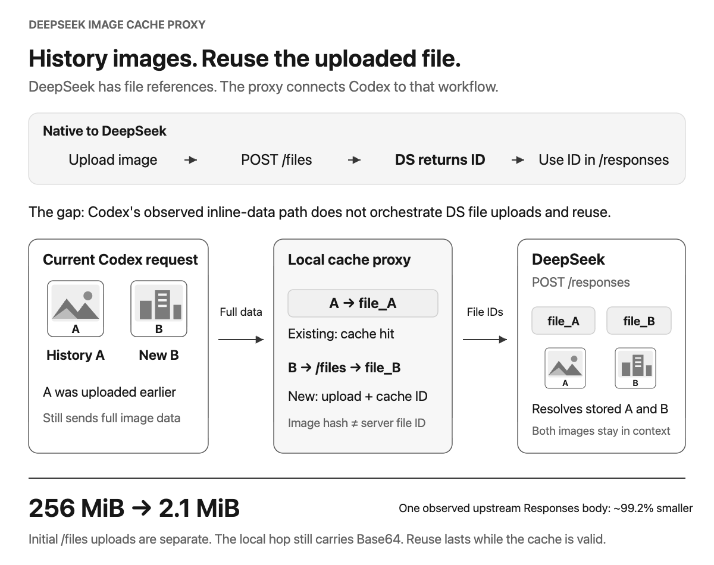
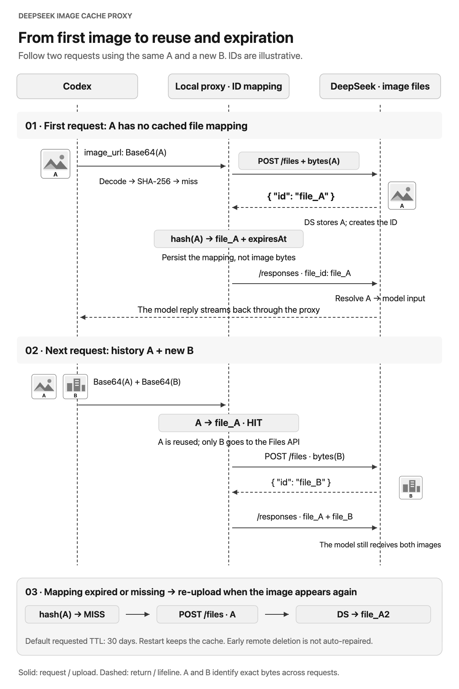

# DeepSeek Image Cache Proxy

**Language:** [简体中文](README.md) · [English](README.en.md)

> Add the missing DeepSeek upload-and-reference lifecycle so historical images do not keep inflating Responses requests.

[](https://github.com/aPuffdog/pixelpass/actions/workflows/ci.yml)
[](https://github.com/aPuffdog/pixelpass/releases)
[](LICENSE)

<picture>
  <source media="(max-width: 600px)" srcset="docs/assets/deepseek-image-cache-proxy.en-mobile.png">
  
</picture>

DeepSeek Image Cache Proxy is a localhost-only Responses API adapter. The concrete problem is that **a new Codex request can carry an image from earlier conversation turns again, even when that image was already uploaded through the proxy, and still send it as inline Base64**. As image history grows, each `/responses` body grows until DeepSeek rejects it with `413 Payload Too Large`.

DeepSeek already provides the [Files API and the `file_id` reference mechanism](https://api-docs.deepseek.com/guides/files_api): upload the image as a file, then reference that file in Responses input. In the Codex provider path handled by this project, images still arrive inline as Base64 without automatically running DeepSeek's “upload, remember the returned ID, reuse it on later requests” lifecycle. This proxy supplies that adapter layer without removing history or changing the image the model sees.

This is not a claim that the two APIs are fundamentally schema-incompatible: [DeepSeek's official Codex configuration](https://api-docs.deepseek.com/quick_start/agent_integrations/codex) already uses Responses, and its [image inputs](https://api-docs.deepseek.com/api/create-response) accept either `image_url` or `file_id`. The missing piece in this path is the DeepSeek file lifecycle, not a blanket inability of Codex to represent file references.

## What problem does it solve?

DeepSeek's current [Responses API is stateless](https://api-docs.deepseek.com/guides/responses_api): it does not support continuing a server-side conversation with `previous_response_id` or `conversation`. Clients must include the required history again. Image files can be stored independently in the account, so historical images still belong in the input, but `file_id` can replace their bytes.

When Codex inspects many screenshots or photos in a long conversation, later requests can carry the same historical Base64 images again. The model context may still be within its token limit while the HTTP request body has already exceeded the DeepSeek Responses API limit:

```text
413 Payload Too Large
Failed to buffer the request body: length limit exceeded
url: https://api.deepseek.com/responses
```

Increasing the model context window does not fix this transport limit. First separate the two network legs:

```text
Codex → localhost proxy: may still contain the full Base64 image history
Local proxy → DeepSeek /responses: inline image bytes become file_id references
```

The proxy reduces the second Responses request, not the Codex-to-localhost leg and not the image itself.

## Full lifecycle: first upload to historical reuse

<picture>
  <source media="(max-width: 600px)" srcset="docs/assets/deepseek-image-cache-proxy.en-lifecycle-mobile.png">
  
</picture>

### First sight of image A: where does `file_id` come from?

1. Codex sends image `A` to the localhost proxy as `input_image.image_url: data:image/...;base64,...`.
2. The proxy decodes the image bytes and computes SHA-256, then looks up `credential fingerprint + SHA-256(A)` in its local cache.
3. On a miss, it uploads the bytes separately to DeepSeek with multipart `POST /files` and `purpose=user_data`.
4. **The proxy does not invent the `file_id`, and the SHA-256 is not the `file_id`.** [DeepSeek returns a file object](https://api-docs.deepseek.com/api/create-file); its response `id` is the account-side `file_id` (for example, `{"id":"file_A"}`).
5. The proxy persists that ID with the credential fingerprint, image hash, size, MIME type, creation time, and expiration time, then replaces every matching `image_url` in this `/responses` request with `file_id: "file_A"`.
6. It forwards the rewritten `/responses`. DeepSeek resolves the reference to the stored image, runs the original input, and streams the response back to Codex.

`file_A` and `file_B` are simplified illustrative IDs. Real IDs are returned by DeepSeek and typically look like `file-api-...`.

### Next request: historical A + new image B

Codex may send historical `A` and new image `B` together, both still as Base64 to localhost. The proxy sees that `A` has the same byte hash as the earlier upload, so it reuses `file_A`. Only uncached `B` is uploaded through `/files`; DeepSeek returns `file_B`. The upstream `/responses` request then carries `file_A + file_B`, not two full image payloads.

If the user adds the exact same `A` again, it also hits the mapping. Multiple occurrences of `A` in one request share one ID, while every message and image position remains in the request. “Duplicate” means **identical decoded image bytes**, not visual similarity; re-encoding can produce a different hash.

The proxy examines only the request it receives and the local mappings it has accumulated. It does not scan other Codex chats or every file in the DeepSeek account. Even a manually uploaded DeepSeek image is a cache miss if the proxy has no active local mapping for it.

### Cache, expiration, and failure states

| State | Actual behavior |
|---|---|
| Credential + image SHA-256 hit and entry is active | Reuse the local `file_id`; no `/files` call for that image |
| First sight, missing cache, or expired local entry | If Base64 is still present, upload again and store DeepSeek's new ID |
| API key / account changes | Different credential fingerprint; use an independent mapping and upload again |
| Restart Codex/proxy, or `off` then `on` | JSON cache remains; active mappings can still be reused |
| Local cache is manually removed | Only the local mapping is removed; the remote DeepSeek file is not deleted |
| Remote file is deleted or expires early | Current version does not invalidate and re-upload automatically after an upstream 404 |
| Network error or HTTP 408/409/429/5xx during upload | Up to 3 retries by default; a final failure aborts the request instead of silently sending Base64 |

The default requested file lifetime is 30 days, and a cache hit does not extend it. `MEDIA_PROXY_FILE_TTL_SECONDS=0` omits `expires_after`; the current [DeepSeek Files documentation](https://api-docs.deepseek.com/guides/files_api) says such files have no expiration, but users can still delete them. DeepSeek shares files between API keys within the same account; this proxy deliberately uses the stricter credential fingerprint, so changing keys causes a cache miss even within one account.

The current implementation coalesces duplicates within one request, but two simultaneous cache misses can still upload the same bytes twice. “Upload once” describes ordinary sequential reuse while the mapping is active, not a permanent global exactly-once guarantee.

## Observed results

These numbers come from a real long-running image conversation rather than a theoretical estimate. “Without” and “with” compare the decoded Responses body before and the forwarded body after rewrite; they are not local disk usage and do not include separate `/files` upload traffic:

| Scenario | Without the proxy | With the proxy | Change |
|---|---:|---:|---:|
| Latest request with 183 images | about 256 MiB | about 2.1 MiB | about 99.2% smaller |
| Cumulative body size across 455 requests | 73.6 GiB | 632.8 MiB | much less repeated transfer |
| Reused cached images | — | 52,382 references | same images reuse existing IDs |

`73.6 GiB` adds up the pre-rewrite bodies of 455 Responses requests. It is not one image's size or the cache's disk footprint. Incoming bodies are measured after decompression; outgoing bodies are measured as forwarded. If HTTP compression is active, this comparison is also not the same as a full network capture.

Actual savings depend on image count, repetition, conversation length, and cache hit rate. The proxy reduces request-body bytes; it does not compress images, reduce quality, or reduce visual-token usage.

## Quick start

Requirements:

- macOS or Windows 10/11
- Codex already configured with a DeepSeek Responses provider
- Node.js 22.15 or newer. On Windows, the installer must resolve `node.exe`; it stores that absolute path in the scheduled task so a later PATH change does not break startup.

Download the release package for your platform from [GitHub Releases](https://github.com/aPuffdog/pixelpass/releases/latest):

- macOS: [`pixelpass-v0.3.1-macos.tar.gz`](https://github.com/aPuffdog/pixelpass/releases/download/v0.3.1/pixelpass-v0.3.1-macos.tar.gz)
- Windows: [`pixelpass-v0.3.1-windows.zip`](https://github.com/aPuffdog/pixelpass/releases/download/v0.3.1/pixelpass-v0.3.1-windows.zip)

### macOS

```bash
tar -xzf pixelpass-v0.3.1-macos.tar.gz
cd pixelpass
sh ./install.sh
./pixelpass status
```

The installer will:

1. Start a localhost proxy listening only on `127.0.0.1:17892`.
2. Register a LaunchAgent for the current macOS user.
3. Wait for the health check to pass.
4. Back up `~/.codex/config.toml`.
5. Change only the active provider's `base_url`.

After installation, fully quit and reopen Codex, then create or fork a task.

### Windows

Extract the ZIP, open PowerShell in the resulting `pixelpass` folder, and run:

```powershell
.\pixelpass.cmd on -ProviderId custom
.\pixelpass.cmd status
```

Replace `custom` with the actual DeepSeek provider name in `%USERPROFILE%\.codex\config.toml`. The installer starts a proxy bound to `127.0.0.1:17892`, registers a per-user scheduled task, backs up configuration, and changes only that provider's `base_url`. Fully quit and reopen Codex afterwards.

Everyday Windows controls mirror the macOS commands:

```powershell
.\pixelpass.cmd on -ProviderId custom  # start and route Codex through the proxy
.\pixelpass.cmd status                 # inspect health, routing, and statistics
.\pixelpass.cmd off                    # restore direct routing and stop
```

`stop`, `start`, and `restart` control only the proxy service; use `off` to shut down the full routing setup.

### Check or restore

macOS:

```bash
./pixelpass status
./pixelpass on
./pixelpass off
```

`off` restores direct Codex traffic and stops the proxy. The proxy uses the authentication information Codex already sends; you do not need to copy or enter another API key. The legacy `./deepseek-proxy` command remains available for existing installations.

## macOS daily control

| Command | What it does |
|---|---|
| `./pixelpass status` | Shows proxy health, Codex routing, image counts, and request-body statistics |
| `./pixelpass on` | Starts the proxy and routes Codex through it |
| `./pixelpass off` | Restores direct Codex traffic and stops the proxy |
| `./pixelpass start` | Starts only the proxy; does not change Codex configuration |
| `./pixelpass stop` | Stops only the proxy; does not change Codex configuration |
| `./pixelpass restart` | Restarts the proxy |
| `./pixelpass doctor` | Checks the runtime, configuration, health, and routing |

## How it works

```text
Codex
  → POST http://127.0.0.1:17892/responses
  → Decompress gzip / deflate / Brotli / zstd requests
  → Extract Base64 images from input_image, including historical images carried again
  → Hash decoded bytes with SHA-256 and look up credential fingerprint + image hash
  → On a miss: upload to DeepSeek POST /files
  → Read DeepSeek's returned payload.id and persist the file_id mapping
  → Replace every matching image_url with file_id
  → Forward to https://api.deepseek.com/responses
  → Stream the response back unchanged
```

Requests containing hundreds of images, including requests larger than Node.js's single-string limit, use a Buffer-level rewrite path. In managed macOS mode, the local entry point accepts up to 1 GiB by default. The Responses request forwarded to DeepSeek uses image references; first-seen images are still uploaded separately through the Files API. `file_id` comes from the DeepSeek `/files` response, not from a locally generated substitute.

Implementation map: [image detection and rewrite](src/rewrite.js), [DeepSeek upload and returned ID](src/deepseek-files.js), [cache and expiration](src/cache.js), [request forwarding and statistics](src/proxy-server.js).

## Security and privacy

- The proxy binds to `127.0.0.1` by default and is not exposed to your LAN or the public internet.
- It does not log prompts, image contents, Authorization headers, or API keys.
- The local cache stores only an account fingerprint, image hash, DeepSeek `file_id`, size, and expiration time.
- Codex configuration is backed up before modification; `off` restores direct routing before stopping the proxy.
- Upload failures stop the request by default instead of silently falling back to a 413-prone Base64 request.
- Images are stored on the DeepSeek account side and expire after 30 days by default; the local cache stores the mapping, not image bytes.
- The cache and Codex configuration are never included in GitHub release packages.

## Troubleshooting

### `status` says “direct to DeepSeek”

The proxy may be running, but Codex has not switched to it. Run `./pixelpass on`, then fully quit and reopen Codex and create or fork a task.

### A `127.0.0.1:17892` 413 still appears

This is the local entry-point limit, not the upstream DeepSeek limit. Run `./pixelpass status` and inspect the configured request-body limit. If the conversation keeps growing without bound, start a new task and carry over a short handoff summary.

### A `api.deepseek.com/responses` 413 still appears

The request is not correctly passing through the proxy, or the upstream is still receiving inline images. Run:

```bash
./pixelpass doctor
./pixelpass status
```

### Image upload fails

Check `lastError` in `status`, and confirm that the selected DeepSeek model and account support `input_image.file_id`. The proxy does not fall back to Base64 by default.

## Configuration

| Environment variable | Default | Description |
|---|---:|---|
| `MEDIA_PROXY_HOST` | `127.0.0.1` | Listen address; changing it is not recommended |
| `MEDIA_PROXY_PORT` | `17892` | Local port |
| `DEEPSEEK_BASE_URL` | `https://api.deepseek.com` | Upstream API base URL |
| `MEDIA_PROXY_FILE_TTL_SECONDS` | `2592000` | Request a 30-day file lifetime; `0` omits `expires_after` (no expiration in current DeepSeek docs) |
| `MEDIA_PROXY_MAX_REQUEST_BYTES` | `1073741824` | Managed macOS entry-point limit: 1 GiB |
| `MEDIA_PROXY_UPLOAD_CONCURRENCY` | `4` | Concurrent uploads per request |
| `MEDIA_PROXY_UPLOAD_RETRIES` | `3` | Upload retry count |
| `MEDIA_PROXY_ALLOW_INLINE_FALLBACK` | `false` | Whether a failed upload may fall back to Base64 |

## Known limitations

- macOS uses LaunchAgent and Windows uses Task Scheduler; both expose `on`, `status`, and `off` through their native command entry point.
- Only the HTTP Responses API is handled; WebSocket is not supported.
- PNG, JPEG, WebP, and GIF are supported.
- A `file_id` belongs to the DeepSeek account that created it and cannot be sent to another provider.
- The proxy does not reduce image tokens or choose animation frames or key screenshots for you.

## Development

The static project homepage lives at [`docs/index.html`](docs/index.html), with language switching, macOS / Windows downloads, install steps, and lifecycle diagrams. Serve `docs/` with any static server to preview or deploy it; the old `docs/preview.html` redirects to the homepage. Page sources are maintained independently of the illustration generator, so regenerating assets does not overwrite the site.

```bash
node --test tests/*.test.js
npm run check
npm run package:release
```

The release command produces a macOS TAR.GZ and a Windows ZIP, each with a matching `.sha256` file. GitHub Actions runs the proxy tests on both macOS and Windows, parses every PowerShell script and exercises `on → status → stop → start → off` on Windows, and verifies both release archives on macOS.

## License

[MIT](LICENSE)
