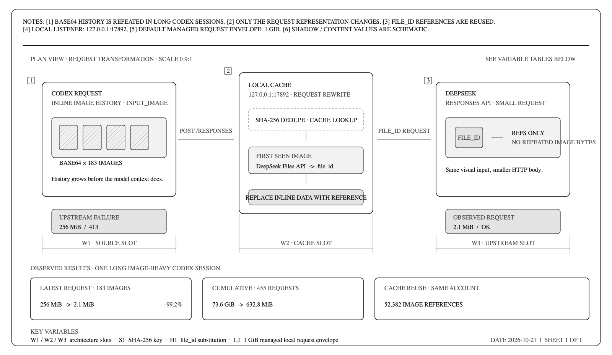

# DeepSeek Image Cache Proxy

**Language:** [简体中文](README.md) · [English](README.en.md)

> Cache repeated images for Codex's DeepSeek requests so long image-heavy conversations keep working.

[](https://github.com/aPuffdog/pixelpass/actions/workflows/ci.yml)
[](https://github.com/aPuffdog/pixelpass/releases)
[](LICENSE)

<picture>
  <source media="(max-width: 600px)" srcset="docs/assets/deepseek-image-cache-proxy.en-mobile.png">
  
</picture>

DeepSeek Image Cache Proxy is a localhost-only Responses API relay for Codex. It uploads repeated Base64 images to the DeepSeek Files API, replaces inline image data with cacheable `file_id` references, and keeps oversized HTTP request bodies from reaching the upstream API.

## What problem does it solve?

When Codex inspects many screenshots or photos in a long conversation, later requests can carry the same historical Base64 images again. The model context may still be within its token limit while the HTTP request body has already exceeded the DeepSeek Responses API limit:

```text
413 Payload Too Large
Failed to buffer the request body: length limit exceeded
url: https://api.deepseek.com/responses
```

Increasing the model context window does not fix this transport limit. The proxy rewrites the request before it leaves your machine:

```text
Codex image history (Base64)
        ↓
Local SHA-256 deduplication and file_id cache
        ↓
DeepSeek receives a small Responses request
```

## Observed results

These numbers come from a real long-running image conversation rather than a theoretical estimate:

| Scenario | Without the proxy | With the proxy | Change |
|---|---:|---:|---:|
| Latest request with 183 images | about 256 MiB | about 2.1 MiB | about 99.2% smaller |
| Cumulative body size across 455 requests | 73.6 GiB | 632.8 MiB | much less repeated transfer |
| Reused cached images | — | 52,382 references | same images reuse existing IDs |

Actual savings depend on image count, repetition, conversation length, and cache hit rate. The proxy reduces request-body bytes; it does not compress images, reduce quality, or reduce visual-token usage.

## Quick start

Requirements:

- macOS
- Codex already configured with a DeepSeek Responses provider
- Node.js 22.15 or newer; Codex's bundled Node.js also works

Clone and install:

```bash
git clone https://github.com/aPuffdog/pixelpass.git
cd pixelpass
./install.sh
```

The installer will:

1. Start a localhost proxy listening only on `127.0.0.1:17892`.
2. Register a LaunchAgent for the current macOS user.
3. Wait for the health check to pass.
4. Back up `~/.codex/config.toml`.
5. Change only the active provider's `base_url`.

After installation, fully quit and reopen Codex, then create or fork a task.

Check the current state:

```bash
./pixelpass status
```

Enable or disable Codex routing through the proxy:

```bash
./pixelpass on
./pixelpass off
```

`off` restores direct Codex traffic and stops the proxy. The proxy uses the authentication information Codex already sends; you do not need to copy or enter another API key. The legacy `./deepseek-proxy` command remains available for existing installations.

## Daily control

| Command | What it does |
|---|---|
| `./pixelpass status` | Shows proxy health, Codex routing, image counts, and request-body statistics |
| `./pixelpass on` | Starts the proxy and routes Codex through it |
| `./pixelpass off` | Restores direct Codex traffic and stops the proxy |
| `./pixelpass start` | Starts only the proxy; does not change Codex configuration |
| `./pixelpass stop` | Stops only the proxy; does not change Codex configuration |
| `./pixelpass restart` | Restarts the proxy |
| `./pixelpass doctor` | Checks the runtime, configuration, health, and routing |

## How it works



```text
Codex
  → POST http://127.0.0.1:17892/responses
  → Decompress gzip / deflate / Brotli / zstd requests
  → Extract Base64 images from input_image
  → Deduplicate with SHA-256 and check the local cache
  → On a miss: upload to DeepSeek POST /files
  → Replace image_url with file_id
  → Forward to https://api.deepseek.com/responses
  → Stream the response back unchanged
```

Requests containing hundreds of images, including requests larger than Node.js's single-string limit, use a Buffer-level rewrite path. In managed macOS mode, the local entry point accepts up to 1 GiB by default. The Responses request forwarded to DeepSeek usually contains only image references; first-seen images are still uploaded separately through the Files API.

## Security and privacy

- The proxy binds to `127.0.0.1` by default and is not exposed to your LAN or the public internet.
- It does not log prompts, image contents, Authorization headers, or API keys.
- The local cache stores only an account fingerprint, image hash, DeepSeek `file_id`, size, and expiration time.
- Codex configuration is backed up before modification; `off` restores direct routing before stopping the proxy.
- Upload failures stop the request by default instead of silently falling back to a 413-prone Base64 request.
- Images are stored on the DeepSeek account side and expire after 30 days by default.
- The cache and Codex configuration are never included in GitHub release packages.

## Troubleshooting

### `status` says “direct to DeepSeek”

The proxy may be running, but Codex has not switched to it. Run `./pixelpass on`, then fully quit and reopen Codex and create or fork a task.

### A `127.0.0.1:17892` 413 still appears

This is the local entry-point limit, not the upstream DeepSeek limit. Run `./pixelpass status` and inspect the configured request-body limit. If the conversation keeps growing without bound, start a new task and carry over a short handoff summary.

### A `api.deepseek.com/responses` 413 still appears

The request is not correctly passing through the proxy, or the upstream is still receiving inline images. Run:

```bash
./pixelpass doctor
./pixelpass status
```

### Image upload fails

Check `lastError` in `status`, and confirm that the selected DeepSeek model and account support `input_image.file_id`. The proxy does not fall back to Base64 by default.

## Configuration

| Environment variable | Default | Description |
|---|---:|---|
| `MEDIA_PROXY_HOST` | `127.0.0.1` | Listen address; changing it is not recommended |
| `MEDIA_PROXY_PORT` | `17892` | Local port |
| `DEEPSEEK_BASE_URL` | `https://api.deepseek.com` | Upstream API base URL |
| `MEDIA_PROXY_FILE_TTL_SECONDS` | `2592000` | File lifetime: 30 days; `0` means no expiration |
| `MEDIA_PROXY_MAX_REQUEST_BYTES` | `1073741824` | Managed macOS entry-point limit: 1 GiB |
| `MEDIA_PROXY_UPLOAD_CONCURRENCY` | `4` | Concurrent uploads per request |
| `MEDIA_PROXY_UPLOAD_RETRIES` | `3` | Upload retry count |
| `MEDIA_PROXY_ALLOW_INLINE_FALLBACK` | `false` | Whether a failed upload may fall back to Base64 |

## Known limitations

- The unified control entry point currently supports macOS LaunchAgents; Windows keeps the legacy Task Scheduler scripts.
- Only the HTTP Responses API is handled; WebSocket is not supported.
- PNG, JPEG, WebP, and GIF are supported.
- A `file_id` belongs to the DeepSeek account that created it and cannot be sent to another provider.
- The proxy does not reduce image tokens or choose animation frames or key screenshots for you.

## Development

```bash
node --test tests/*.test.js
npm run check
npm run package:release
```

The release command produces `dist/pixelpass-v<version>.tar.gz` and the matching `.sha256` file. GitHub Actions repeats tests, syntax checks, and release-package verification on macOS.

## License

[MIT](LICENSE)
