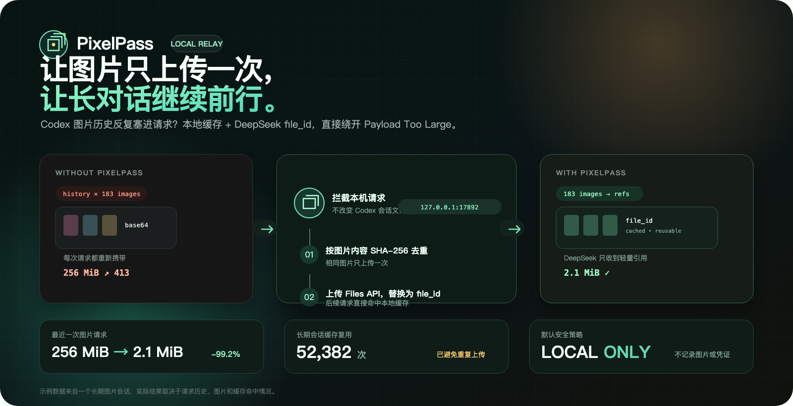

# PixelPass

> 让图片只上传一次，让长对话继续前行。

[](https://github.com/aPuffdog/pixelpass/actions/workflows/ci.yml)
[](https://github.com/aPuffdog/pixelpass/releases)
[](LICENSE)



PixelPass 是一个只监听本机的 Responses API 中转工具。它把 Codex 请求里反复
出现的 Base64 图片上传到 DeepSeek Files API，并将图片替换为可缓存的
`file_id`，从而避免图片历史撑爆 HTTP 请求体。

## 它解决什么问题？

当 Codex 在长会话中查看大量截图或照片时，后续每次请求都可能重新携带之前的
Base64 图片。模型上下文也许还没有接近 token 上限，但 HTTP 请求体已经超过
DeepSeek Responses API 的 48 MiB 限制，于是出现：

```text
413 Payload Too Large
Failed to buffer the request body: length limit exceeded
url: https://api.deepseek.com/responses
```

这不是增加 token 上下文就能解决的问题。PixelPass 在请求离开本机以前完成改写：

```text
Codex 历史图片（Base64）
        ↓
本地 SHA-256 去重与 file_id 缓存
        ↓
DeepSeek 只收到很小的 Responses 请求
```

## 效果怎么样？

以下数据来自一次真实的长期图片会话，不是理论值：

| 指标 | 不使用 PixelPass | 使用 PixelPass |
|---|---:|---:|
| 最近一次 183 张图片的请求体 | 约 256 MiB | 约 2.1 MiB |
| 单次体积变化 | — | 减少约 99.2% |
| 相同图片 | 每个请求重复上传和传输 | 命中缓存，只保留引用 |
| 长期会话累计请求体（455 次） | 73.6 GiB | 632.8 MiB |
| 实测缓存复用 | — | 52,382 张次 |

实际节省取决于图片数量、会话长度和缓存命中率。PixelPass 解决的是**请求体
字节数**，不会减少图片自身消耗的视觉 token。

## 快速开始

环境要求：

- macOS
- 已经配置 DeepSeek Responses provider 的 Codex
- Node.js 22.15+；也可以使用 Codex 自带的 Node.js

克隆并安装：

```bash
git clone https://github.com/aPuffdog/pixelpass.git
cd pixelpass
./install.sh
```

安装脚本会：

1. 启动仅监听 `127.0.0.1:17892` 的本地代理。
2. 注册当前用户的 macOS LaunchAgent。
3. 等待健康检查通过。
4. 备份 `~/.codex/config.toml`。
5. 只修改当前 provider 的 `base_url`。

安装后**完全退出并重新打开 Codex**，再新建或 fork 一个任务。

检查状态：

```bash
./pixelpass status
```

关闭整套服务并恢复 Codex 直连：

```bash
./pixelpass off
```

PixelPass 使用 Codex 原本发送的认证信息，不需要额外复制或填写 API Key。

## 日常控制

| 命令 | 作用 |
|---|---|
| `./pixelpass status` | 查看代理、Codex 路由、图片和请求体统计 |
| `./pixelpass on` | 启动代理并让 Codex 经过代理 |
| `./pixelpass off` | 恢复 Codex 直连并关闭代理 |
| `./pixelpass start` | 只启动代理，不修改 Codex 配置 |
| `./pixelpass stop` | 只停止代理，不修改 Codex 配置 |
| `./pixelpass restart` | 重启代理 |
| `./pixelpass doctor` | 检查运行时、配置、健康状态和路由 |

旧命令 `./deepseek-proxy` 继续保留，避免已有安装失效。

## 工作原理

```text
Codex
  → POST http://127.0.0.1:17892/responses
  → PixelPass 解压 gzip / deflate / Brotli / zstd
  → 提取 input_image 中的 Base64 图片
  → SHA-256 去重并查询本地缓存
  → 未命中：上传 DeepSeek POST /files
  → image_url 替换为 file_id
  → 转发到 https://api.deepseek.com/responses
  → 原样流式返回响应
```

包含数百张图片、超过 Node.js 单字符串长度的大请求会使用 Buffer 级改写路径。
macOS 托管模式默认允许最高 1 GiB 的本地请求体，最终发给 DeepSeek 的仍是轻量
`file_id` 请求。

## 安全与隐私

- 默认只绑定 `127.0.0.1`，不对局域网或公网开放。
- 不记录 prompt、图片内容、Authorization 或 API Key。
- 本地缓存只保存账号指纹、图片哈希、DeepSeek `file_id`、大小和过期时间。
- 修改 Codex 配置前自动备份；`off` 会优先恢复直连再停止代理。
- 上传失败时默认终止请求，不会静默退回可能触发 413 的 Base64。
- 图片由 DeepSeek 账户侧保存，默认 30 天过期。
- 缓存和 Codex 配置不会被打进 GitHub 发布包。

## 常见问题

### `status` 显示“直连 DeepSeek”

代理可能启动了，但 Codex 还没有接管。执行：

```bash
./pixelpass on
```

然后完全退出并重新打开 Codex，新建或 fork 任务。

### 仍出现 `127.0.0.1:17892` 的 413

这是 PixelPass 的本地入口限制，而不是 DeepSeek 上游限制。先运行 `status`
查看入口上限；如果会话长期无限增长，建议另开任务并携带一份简短交接摘要。

### 出现 `api.deepseek.com/responses` 的 413

这说明请求没有正确经过 PixelPass，或者上游仍收到内联图片。运行：

```bash
./pixelpass doctor
./pixelpass status
```

### 图片上传失败

检查 `status` 中的 `lastError`，并确认当前 DeepSeek 模型和账户支持
`input_image.file_id`。默认不会回退到 Base64。

## 配置

| 环境变量 | 默认值 | 说明 |
|---|---:|---|
| `MEDIA_PROXY_HOST` | `127.0.0.1` | 监听地址，不建议修改 |
| `MEDIA_PROXY_PORT` | `17892` | 本地端口 |
| `DEEPSEEK_BASE_URL` | `https://api.deepseek.com` | 上游地址 |
| `MEDIA_PROXY_FILE_TTL_SECONDS` | `2592000` | 文件 30 天过期；`0` 表示永久 |
| `MEDIA_PROXY_MAX_REQUEST_BYTES` | `1073741824` | macOS 托管入口上限，1 GiB |
| `MEDIA_PROXY_UPLOAD_CONCURRENCY` | `4` | 单次请求并发上传数 |
| `MEDIA_PROXY_UPLOAD_RETRIES` | `3` | 上传重试次数 |
| `MEDIA_PROXY_ALLOW_INLINE_FALLBACK` | `false` | 是否允许失败后回退 Base64 |

## 已知限制

- 统一控制入口目前只实现了 macOS LaunchAgent；Windows 保留旧版计划任务脚本。
- 仅处理 HTTP Responses API，不支持 WebSocket。
- 支持 PNG、JPEG、WebP、GIF。
- `file_id` 只属于 DeepSeek 账户，不能发给其他 provider。
- 不会减少图片 token，也不会替用户筛选动画帧或关键截图。

## 开发

```bash
node --test tests/*.test.js
npm run check
npm run package:release
```

打包会生成：

```text
dist/pixelpass-v<version>.tar.gz
dist/pixelpass-v<version>.tar.gz.sha256
```

测试使用 Codex 自带的 Node.js 24.22.1 验证；GitHub Actions 会在 macOS 上重复
执行测试、语法检查和发布包校验。

## License

[MIT](LICENSE)
