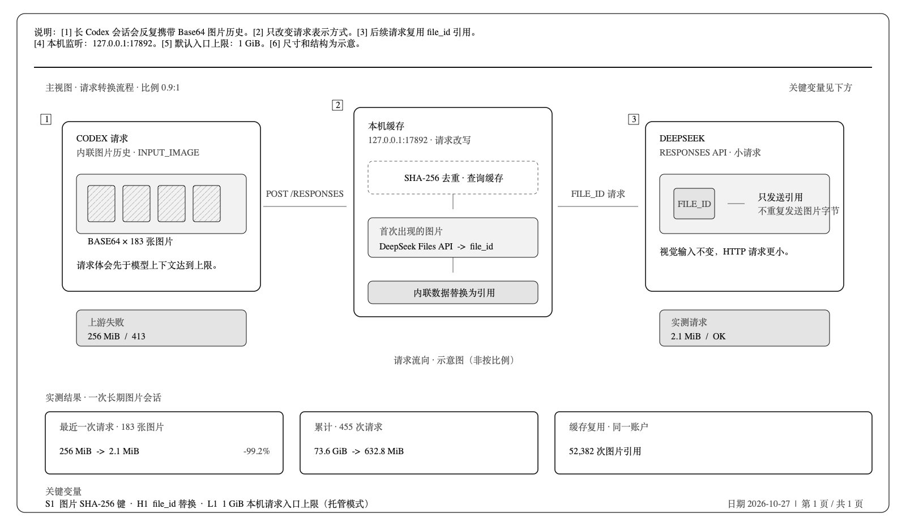

# DeepSeek Image Cache Proxy

**语言 / Language:** [简体中文](README.md) · [English](README.en.md)

> 为 Codex 的 DeepSeek 图片请求缓存重复图片，减少长会话请求体积，避免 `413 Payload Too Large`。

[](https://github.com/aPuffdog/pixelpass/actions/workflows/ci.yml)
[](https://github.com/aPuffdog/pixelpass/releases)
[](LICENSE)

<picture>
  <source media="(max-width: 600px)" srcset="docs/assets/deepseek-image-cache-proxy.zh-CN-mobile.png">
  
</picture>

DeepSeek Image Cache Proxy 是一个运行在本机的 Responses API 代理。长对话里，Codex 可能在后续请求中反复携带历史图片的 Base64 数据；图片越多，请求体越大，最终可能在模型上下文达到上限前就被 DeepSeek 拒绝。

代理会识别重复图片、将新图片上传到 DeepSeek Files API，并把请求中的 Base64 图片替换成可复用的 `file_id`。这样 DeepSeek 收到的是小得多的请求，而 Codex 仍按原来的方式发起对话。

## 它解决什么问题？

当请求体超过 DeepSeek Responses API 的限制时，常见报错是：

```text
413 Payload Too Large
Failed to buffer the request body: length limit exceeded
url: https://api.deepseek.com/responses
```

这通常是 HTTP 请求体过大，不代表模型 token 上下文已经用完。代理在请求离开本机前改写图片表示：

```text
Codex 历史图片（Base64）
        ↓
本机代理按图片内容计算 SHA-256，并查找缓存
        ↓
新图片上传到 DeepSeek Files API，后续请求复用 file_id
        ↓
DeepSeek Responses API 收到更小的请求
```

## 实测效果

以下数据来自一次真实的长期图片会话：

| 场景 | 原始请求体 | 使用代理后 | 变化 |
|---|---:|---:|---:|
| 最近一次请求，183 张图片 | 约 256 MiB | 约 2.1 MiB | 减少约 99.2% |
| 455 次请求累计 | 73.6 GiB | 632.8 MiB | 大幅减少重复传输 |
| 图片缓存复用 | — | 52,382 张次 | 相同图片使用已有引用 |

这些是单个会话的观测结果，实际节省取决于图片数量、重复率、会话长度和缓存命中率。代理减少的是 HTTP 请求体字节数；它不会压缩图片、降低画质或减少视觉 token。

## 安装与开始使用

需要 macOS、Node.js 22.15 或更新版本（也可使用 Codex 自带的 Node.js），并已在 Codex 中配置 DeepSeek Responses provider。

```bash
git clone https://github.com/aPuffdog/pixelpass.git
cd pixelpass
./install.sh
```

安装会启动只监听 `127.0.0.1:17892` 的本机代理、注册 macOS LaunchAgent，并备份后更新当前 Codex provider 的 `base_url`。安装完成后，完全退出并重新打开 Codex，再开始一个新任务或 fork 现有任务。

确认运行状态：

```bash
./pixelpass status
```

打开或关闭 Codex 代理路由：

```bash
./pixelpass on
./pixelpass off
```

`off` 会恢复 Codex 直连 DeepSeek 并关闭代理。代理使用 Codex 原有的认证信息，不需要另行复制 API Key。已有用户也可以继续使用兼容命令 `./deepseek-proxy`。

## 日常控制

| 命令 | 作用 |
|---|---|
| `./pixelpass status` | 查看代理、Codex 路由、图片和请求体统计 |
| `./pixelpass on` | 启动代理并让 Codex 经过代理 |
| `./pixelpass off` | 恢复 Codex 直连并关闭代理 |
| `./pixelpass start` | 只启动代理，不修改 Codex 配置 |
| `./pixelpass stop` | 只停止代理，不修改 Codex 配置 |
| `./pixelpass restart` | 重启代理 |
| `./pixelpass doctor` | 检查运行时、配置、健康状态和路由 |

## 工作原理



```text
Codex
  → POST http://127.0.0.1:17892/responses
  → 解压 gzip / deflate / Brotli / zstd 请求
  → 提取 input_image 中的 Base64 图片
  → 按 SHA-256 去重并查找本地 file_id 缓存
  → 缓存未命中时，上传 DeepSeek POST /files
  → 将 image_url 替换为 file_id
  → 转发到 https://api.deepseek.com/responses
  → 原样流式返回响应
```

大量图片或超过 Node.js 单字符串长度的请求会通过 Buffer 路径改写。macOS 托管模式默认允许最高 1 GiB 的本地请求体；转发到 DeepSeek 的 Responses 请求通常只包含图片引用，首次出现的图片仍会单独上传到 Files API。

## 安全与隐私

- 默认仅监听 `127.0.0.1`，不向局域网或公网开放。
- 不记录 prompt、图片内容、Authorization 或 API Key。
- 本地缓存只保存账号指纹、图片哈希、DeepSeek `file_id`、大小和过期时间。
- 修改 Codex 配置前会自动备份；`off` 会优先恢复直连再停止代理。
- 上传失败时默认终止请求，不会静默回退到可能过大的 Base64 请求。
- 图片由 DeepSeek 账户侧保存，默认 30 天过期。
- 缓存和 Codex 配置不会被放入 GitHub 发布包。

## 常见问题

### 状态显示“直连 DeepSeek”

代理可能已运行，但 Codex 路由尚未启用。执行 `./pixelpass on`，完全退出并重新打开 Codex，再新建或 fork 一个任务。

### 仍然收到 `127.0.0.1:17892` 的 413

这是本机代理入口的请求大小上限。运行 `./pixelpass status` 查看当前上限；如果长会话持续增长，可以另开任务并带上简短交接摘要。

### 收到 `api.deepseek.com/responses` 的 413

请求可能没有经过代理，或上游仍收到内联图片。运行 `./pixelpass doctor` 和 `./pixelpass status` 检查路由和最近的请求统计。

### 图片上传失败

查看 `status` 中的 `lastError`，并确认当前 DeepSeek 模型和账户支持 `input_image.file_id`。默认策略不会退回 Base64。

## 配置

| 环境变量 | 默认值 | 说明 |
|---|---:|---|
| `MEDIA_PROXY_HOST` | `127.0.0.1` | 监听地址，不建议修改 |
| `MEDIA_PROXY_PORT` | `17892` | 本地端口 |
| `DEEPSEEK_BASE_URL` | `https://api.deepseek.com` | 上游地址 |
| `MEDIA_PROXY_FILE_TTL_SECONDS` | `2592000` | 文件 30 天过期；`0` 表示永久 |
| `MEDIA_PROXY_MAX_REQUEST_BYTES` | `1073741824` | macOS 托管入口上限，1 GiB |
| `MEDIA_PROXY_UPLOAD_CONCURRENCY` | `4` | 单次请求并发上传数 |
| `MEDIA_PROXY_UPLOAD_RETRIES` | `3` | 上传重试次数 |
| `MEDIA_PROXY_ALLOW_INLINE_FALLBACK` | `false` | 是否允许失败后回退 Base64 |

## 已知限制

- 统一控制入口目前只实现了 macOS LaunchAgent；Windows 保留旧版计划任务脚本。
- 仅处理 HTTP Responses API，不支持 WebSocket。
- 支持 PNG、JPEG、WebP、GIF。
- `file_id` 属于 DeepSeek 账户，不能发给其他 provider。
- 不会减少视觉 token，也不会替用户筛选动画帧或关键截图。

## 开发

```bash
node --test tests/*.test.js
npm run check
npm run package:release
```

打包会生成 `dist/pixelpass-v<version>.tar.gz` 及对应的 `.sha256` 校验文件。GitHub Actions 会在 macOS 上运行测试、语法检查和发布包校验。

## License

[MIT](LICENSE)
