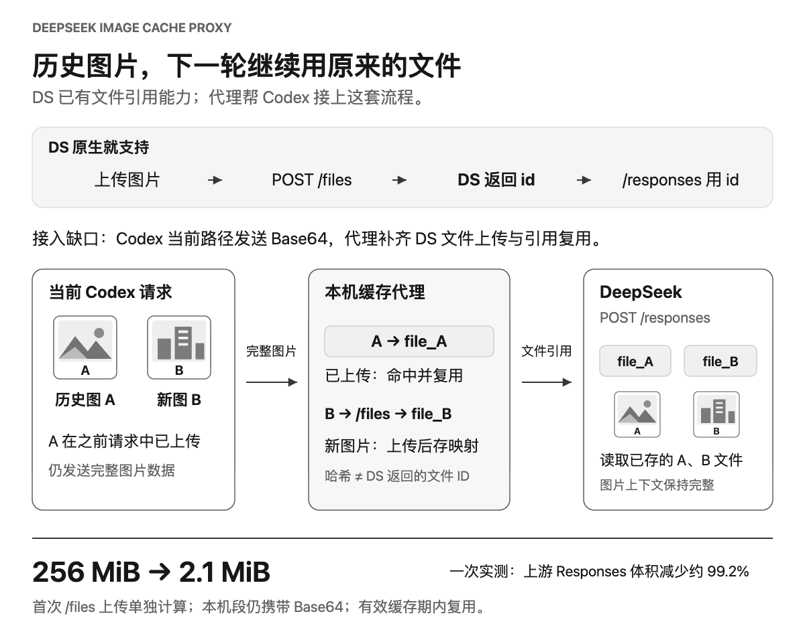
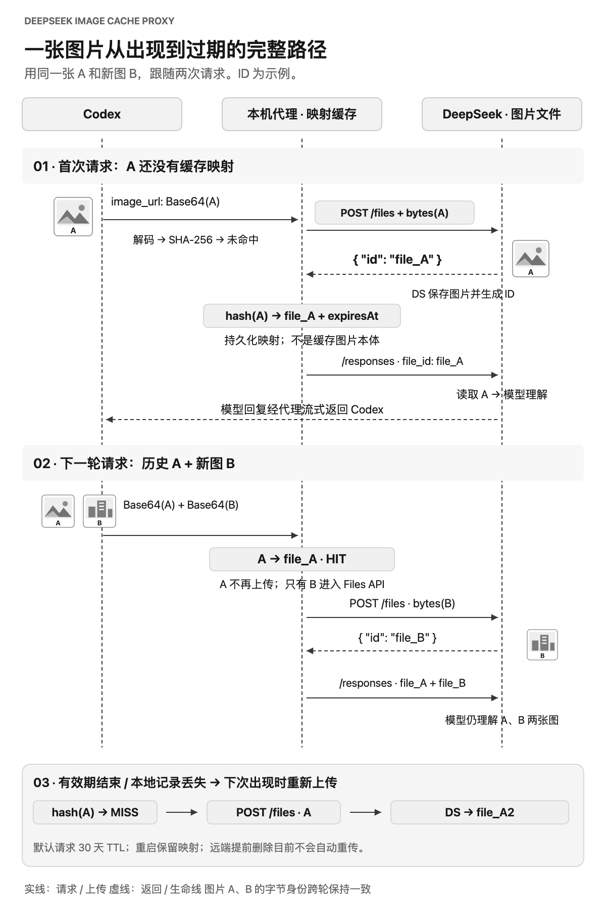

# DeepSeek Image Cache Proxy

**语言 / Language:** [简体中文](README.md) · [English](README.en.md)

> 为 Codex 补上 DeepSeek 图片上传与引用复用流程，让历史图片不再反复撑大 Responses 请求。

[](https://github.com/aPuffdog/pixelpass/actions/workflows/ci.yml)
[](https://github.com/aPuffdog/pixelpass/releases)
[](LICENSE)

<picture>
  <source media="(max-width: 600px)" srcset="docs/assets/deepseek-image-cache-proxy.zh-CN-mobile.png">
  
</picture>

DeepSeek Image Cache Proxy 是一个运行在本机的 Responses API 适配层。它解决的问题是：**Codex 在当前请求中再次携带了历史会话里的图片，即使这些图片此前已经通过代理上传到 DeepSeek，仍然以内联 Base64 发送。** 历史图片越多，每次请求体就越大，最终可能在模型上下文达到上限前先触发 `413 Payload Too Large`。

DeepSeek 本身已经提供 [Files API 和 `file_id` 引用机制](https://api-docs.deepseek.com/guides/files_api)：图片先作为文件上传，之后在 Responses 输入里引用文件 ID。在本项目处理的 Codex provider 请求路径中，图片仍以内联 Base64 发出，没有自动完成 DeepSeek 的“上传、保存 ID、后续复用”流程，代理补上的就是这层适配。它不删除历史消息，也不改变模型看到的图片。

这不是说两个 API 完全不兼容：[DeepSeek 官方 Codex 配置](https://api-docs.deepseek.com/quick_start/agent_integrations/codex)本来就使用 Responses 接口，其[图片输入](https://api-docs.deepseek.com/api/create-response)支持 `image_url` 或 `file_id`。这里缺少的是当前路径对 DeepSeek 文件生命周期的自动接入，不是 Codex 完全无法表示文件引用。

## 它解决什么问题？

DeepSeek 当前的 [Responses 接口是无状态的](https://api-docs.deepseek.com/guides/responses_api)，不支持用 `previous_response_id` 或 `conversation` 接续服务端会话。客户端需要在多轮请求中重新带入所需历史；图片文件可以独立保存在账户内，所以历史图片仍需出现在输入中，但可以用 `file_id` 代替图片字节。

当请求体超过 DeepSeek Responses API 的限制时，常见报错是：

```text
413 Payload Too Large
Failed to buffer the request body: length limit exceeded
url: https://api.deepseek.com/responses
```

这通常是 HTTP 请求体过大，不代表模型 token 上下文已经用完。先区分两段链路：

```text
Codex → 本机代理：仍可能发送完整 Base64 图片历史
本机代理 → DeepSeek /responses：把图片内联字节改成 file_id
```

代理减少的是第二段 Responses 请求体，不是 Codex 到本机这一段，也不是图片本身的大小。

## 完整生命周期：从首次上传到历史复用

<picture>
  <source media="(max-width: 600px)" srcset="docs/assets/deepseek-image-cache-proxy.zh-CN-lifecycle-mobile.png">
  
</picture>

### 第一次出现图片 A：file_id 从哪里来？

1. Codex 把图片 `A` 作为 `input_image.image_url: data:image/...;base64,...` 发给本机代理。
2. 代理解码图片字节并计算 SHA-256，查询 `账号凭证指纹 + SHA-256(A)` 的本地映射。
3. 未命中缓存时，代理把 `A` 的图片字节单独以 multipart `POST /files` 上传给 DeepSeek，`purpose=user_data`。
4. **[DeepSeek Files API 返回文件对象](https://api-docs.deepseek.com/api/create-file)，响应中的 `id` 才是 `file_id`。** 例如返回 `{"id":"file_A"}`，代理就保存 `file_A`。ID 由 DeepSeek 生成；本地 SHA-256 只是查找键。
5. 代理把文件 ID、图片哈希、大小、MIME、创建时间和过期时间持久化到本地缓存，再将这次请求里 `A` 的每个 `image_url` 改成 `file_id: "file_A"`。
6. 代理转发改写后的 `POST /responses`；DeepSeek 根据引用读取账户侧已保存的图片，继续推理，代理将响应原样流式返回 Codex。

`file_A`、`file_B` 是图中的简化示例；实际 ID 由 DeepSeek 返回，通常形如 `file-api-...`。

### 下一次请求：历史 A + 新图片 B

Codex 的新请求可能包含历史 `A` 和新图片 `B`，两者仍然都是 Base64。代理发现 `A` 的字节哈希与历史上传记录相同，就直接复用 `file_A`；只有没有记录的 `B` 才需要上传 `/files`，由 DeepSeek 返回 `file_B`。本次 `/responses` 最终携带的是 `file_A + file_B`，而不是再次传输两张完整图片。

若用户又添加了一张字节完全相同的 `A`，它也能命中已有映射。同一请求中出现多次的 `A` 会共享一个 ID，但所有消息和图片位置都会保留。这里的“重复”是**解码后的图片字节完全相同**，不是肉眼相似；重新压缩或导出可能无法命中。

代理只检查当前收到的请求，并查询自己积累的本地映射；它不会扫描 Codex 的其他会话或 DeepSeek 账户里所有已上传文件。图片即使曾手动上传到 DeepSeek，只要本地没有它的有效映射，仍按缓存未命中处理。

### 缓存、过期与失败

| 状态 | 实际行为 |
|---|---|
| 当前凭证 + 图片 SHA-256 命中，且未过期 | 复用本地 `file_id`，不再为这张图片调用 `/files` |
| 首次出现、缓存丢失或本地记录已过期 | 当前请求仍含 Base64 时，重新上传并保存 DeepSeek 返回的新 ID |
| 切换 API Key / 账号 | 凭证指纹不同，使用独立缓存记录并重新上传 |
| 重启 Codex / 代理，或 `off` 后再 `on` | JSON 缓存保留；没有过期的映射可以继续复用 |
| 手动移除本地缓存 | 只移除本地映射，不会删除 DeepSeek 账户侧文件 |
| 远端文件提前被删除或失效 | 当前版本不会根据上游 404 自动清理并重传，需要手动处理缓存 |
| 上传遇到网络错误、408/409/429/5xx | 默认最多重试 3 次；仍失败时终止本次请求，不静默退回 Base64 |

默认上传时请求文件在 30 天后过期，复用不会自动延长这个期限。`MEDIA_PROXY_FILE_TTL_SECONDS=0` 表示不发送 `expires_after` 参数；按当前 [DeepSeek Files 文档](https://api-docs.deepseek.com/guides/files_api)，这种文件不设过期时间，但仍可被用户删除。DeepSeek 允许同一账号下的 API Key 共享文件；本代理为隔离凭证，采用更严格的凭证指纹缓存，因此即使账号相同，换 Key 也会未命中。

当前版本只在单个请求内合并重复图片；两个同时到达且都未命中的请求仍可能各自上传一次。因此“上传一次”应理解为有效缓存期内的正常顺序请求复用，不是永久且严格的全局保证。

## 实测效果

以下数据来自一次真实的长期图片会话：

| 场景 | 原始请求体 | 使用代理后 | 变化 |
|---|---:|---:|---:|
| 最近一次请求，183 张图片 | 约 256 MiB | 约 2.1 MiB | 减少约 99.2% |
| 455 次请求累计 | 73.6 GiB | 632.8 MiB | 大幅减少重复传输 |
| 图片缓存复用 | — | 52,382 张次 | 相同图片使用已有引用 |

`73.6 GiB` 是 455 次 Responses 请求在改写前的累计体积，不是某一张图片的大小，也不是磁盘占用。统计把每次收到的解压后请求体相加，再与转发时的请求体比较；单独的 `/files` 上传流量不包含在这组数字里。若原请求使用了 HTTP 压缩，两端统计口径也不同于完整网络抓包。

这些是单个会话的观测结果，实际节省取决于图片数量、重复率、会话长度和缓存命中率。代理减少的是 HTTP 请求体字节数；它不会压缩图片、降低画质或减少视觉 token。

## 安装与开始使用

需要 macOS、Node.js 22.15 或更新版本（也可使用 Codex 自带的 Node.js），并已在 Codex 中配置 DeepSeek Responses provider。

```bash
git clone https://github.com/aPuffdog/pixelpass.git
cd pixelpass
./install.sh
```

安装会启动只监听 `127.0.0.1:17892` 的本机代理、注册 macOS LaunchAgent，并备份后更新当前 Codex provider 的 `base_url`。安装完成后，完全退出并重新打开 Codex，再开始一个新任务或 fork 现有任务。

确认运行状态：

```bash
./pixelpass status
```

打开或关闭 Codex 代理路由：

```bash
./pixelpass on
./pixelpass off
```

`off` 会恢复 Codex 直连 DeepSeek 并关闭代理。代理使用 Codex 原有的认证信息，不需要另行复制 API Key。已有用户也可以继续使用兼容命令 `./deepseek-proxy`。

## 日常控制

| 命令 | 作用 |
|---|---|
| `./pixelpass status` | 查看代理、Codex 路由、图片和请求体统计 |
| `./pixelpass on` | 启动代理并让 Codex 经过代理 |
| `./pixelpass off` | 恢复 Codex 直连并关闭代理 |
| `./pixelpass start` | 只启动代理，不修改 Codex 配置 |
| `./pixelpass stop` | 只停止代理，不修改 Codex 配置 |
| `./pixelpass restart` | 重启代理 |
| `./pixelpass doctor` | 检查运行时、配置、健康状态和路由 |

## 工作原理

```text
Codex
  → POST http://127.0.0.1:17892/responses
  → 解压 gzip / deflate / Brotli / zstd 请求
  → 提取当前请求里的 Base64 图片（包含再次携带的历史图片）
  → 按图片字节 SHA-256 去重，查询“凭证指纹 + 图片哈希”缓存
  → 缓存未命中时，上传 DeepSeek POST /files
  → 接收 DeepSeek 返回的 id，保存为 file_id 映射
  → 将所有对应 image_url 替换为 file_id
  → 转发到 https://api.deepseek.com/responses
  → 原样流式返回响应
```

大量图片或超过 Node.js 单字符串长度的请求会通过 Buffer 路径改写。macOS 托管模式默认允许最高 1 GiB 的本地入口请求体；转发到 DeepSeek 的 Responses 请求使用图片引用，首次出现的图片仍会先单独上传到 Files API。

实现对应：[识别与改写](src/rewrite.js)、[上传并读取 DeepSeek 返回的 ID](src/deepseek-files.js)、[缓存与过期](src/cache.js)、[请求与统计](src/proxy-server.js)。

## 安全与隐私

- 默认仅监听 `127.0.0.1`，不向局域网或公网开放。
- 不记录 prompt、图片内容、Authorization 或 API Key。
- 本地缓存只保存账号指纹、图片哈希、DeepSeek `file_id`、大小和过期时间。
- 修改 Codex 配置前会自动备份；`off` 会优先恢复直连再停止代理。
- 上传失败时默认终止请求，不会静默回退到可能过大的 Base64 请求。
- 图片由 DeepSeek 账户侧保存，默认 30 天过期。
- 缓存和 Codex 配置不会被放入 GitHub 发布包。

## 常见问题

### 状态显示“直连 DeepSeek”

代理可能已运行，但 Codex 路由尚未启用。执行 `./pixelpass on`，完全退出并重新打开 Codex，再新建或 fork 一个任务。

### 仍然收到 `127.0.0.1:17892` 的 413

这是本机代理入口的请求大小上限。运行 `./pixelpass status` 查看当前上限；如果长会话持续增长，可以另开任务并带上简短交接摘要。

### 收到 `api.deepseek.com/responses` 的 413

请求可能没有经过代理，或上游仍收到内联图片。运行 `./pixelpass doctor` 和 `./pixelpass status` 检查路由和最近的请求统计。

### 图片上传失败

查看 `status` 中的 `lastError`，并确认当前 DeepSeek 模型和账户支持 `input_image.file_id`。默认策略不会退回 Base64。

## 配置

| 环境变量 | 默认值 | 说明 |
|---|---:|---|
| `MEDIA_PROXY_HOST` | `127.0.0.1` | 监听地址，不建议修改 |
| `MEDIA_PROXY_PORT` | `17892` | 本地端口 |
| `DEEPSEEK_BASE_URL` | `https://api.deepseek.com` | 上游地址 |
| `MEDIA_PROXY_FILE_TTL_SECONDS` | `2592000` | 请求文件在 30 天后过期；`0` 不发送过期参数，按当前 DeepSeek 文档不设过期 |
| `MEDIA_PROXY_MAX_REQUEST_BYTES` | `1073741824` | macOS 托管入口上限，1 GiB |
| `MEDIA_PROXY_UPLOAD_CONCURRENCY` | `4` | 单次请求并发上传数 |
| `MEDIA_PROXY_UPLOAD_RETRIES` | `3` | 上传重试次数 |
| `MEDIA_PROXY_ALLOW_INLINE_FALLBACK` | `false` | 是否允许失败后回退 Base64 |

## 已知限制

- 统一控制入口目前只实现了 macOS LaunchAgent；Windows 保留旧版计划任务脚本。
- 仅处理 HTTP Responses API，不支持 WebSocket。
- 支持 PNG、JPEG、WebP、GIF。
- `file_id` 属于 DeepSeek 账户，不能发给其他 provider。
- 不会减少视觉 token，也不会替用户筛选动画帧或关键截图。

## 开发

```bash
node --test tests/*.test.js
npm run check
npm run package:release
```

打包会生成 `dist/pixelpass-v<version>.tar.gz` 及对应的 `.sha256` 校验文件。GitHub Actions 会在 macOS 上运行测试、语法检查和发布包校验。

## License

[MIT](LICENSE)
